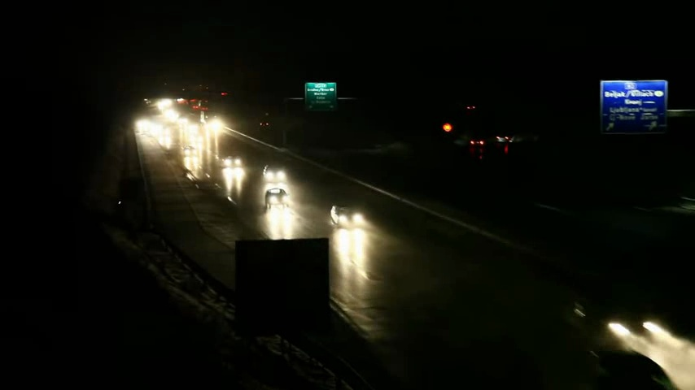
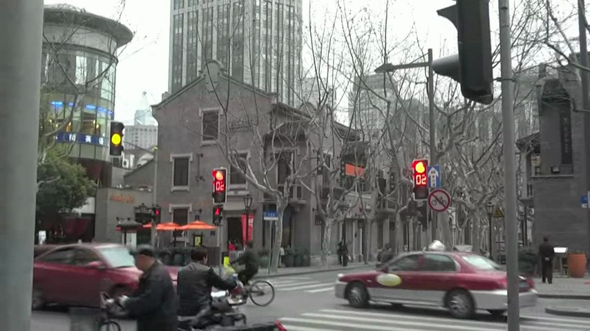
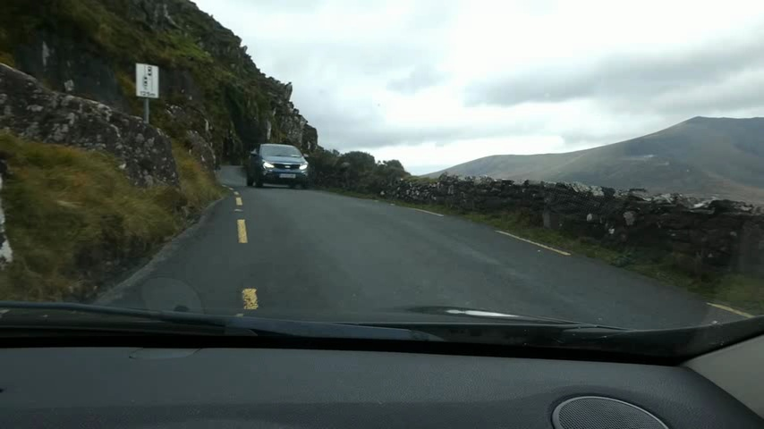
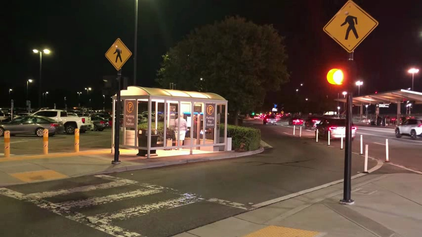
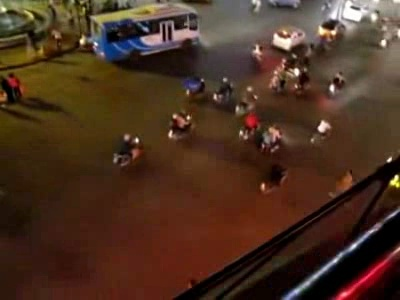
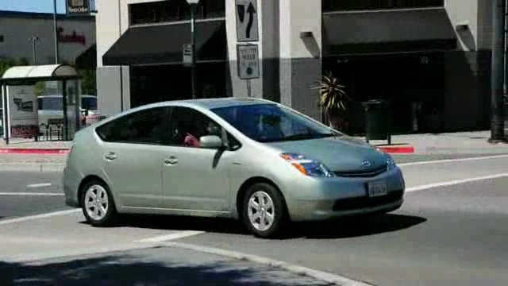
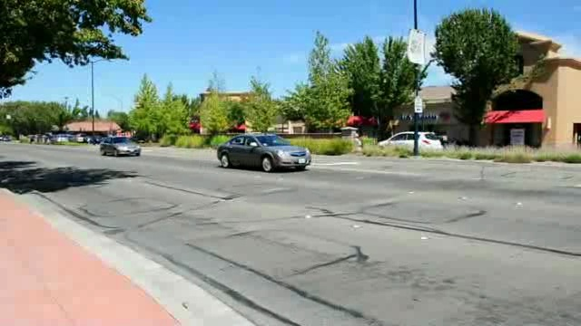
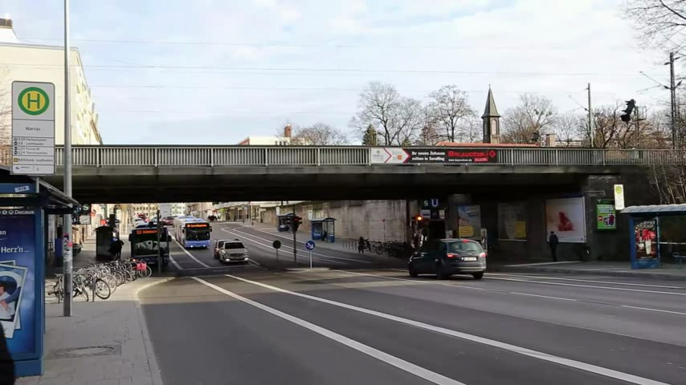
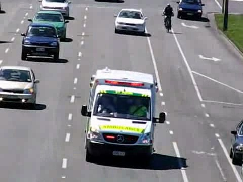
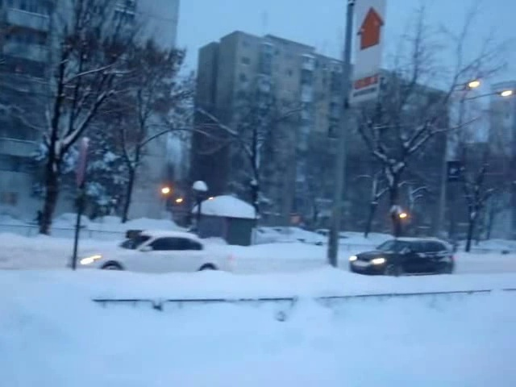

# Ten real traffic footage samples

This folder contains **10 MP4 clips from 10 different source videos**, each
5 seconds long at 15 FPS: 50 seconds and 750 frames in total. They contain
actual moving traffic. The original synthetic plate image and repeated-photo
smoke video are not counted toward these ten clips.

Run one clip from the activated project environment:

```sh
python process_video.py samples/footage/traffic_06.mp4
```

Each clip is unlabelled. No detection/OCR accuracy has been calculated on this
collection, and no traffic violations have been annotated. Distant, dark, blurry,
and low-resolution plates may be unreadable; these are useful difficult cases
but cannot all serve as positive OCR examples. Clips 06 and 09 provide closer
approaching vehicles to inspect first.

Clips 06 and 07 show related street-intersection footage by the same author;
keep them in the same development/test group. Ten source files do not establish
ten statistically independent scenes. This collection is not automatically a
held-out test set; overlap with detector training material is unknown.

## Gallery and attribution

Each clip and its preview retain the source license linked in its row. These
are excerpts adapted for this project: source start times are in `manifest.json`;
audio was removed, video was encoded as MP4, frame rate reduced to at most
15 FPS, and dimensions limited to 1280×720 with even output dimensions.
The best available compact renditions were used, at 300–480p for these samples.
Original footage is hosted on Wikimedia Commons; the linked file pages provide
full provenance and licensing information. No ownership of the original footage
is claimed. Retain these credits and license links when redistributing the clips
or modified versions; share-alike terms apply to the relevant adaptations.

| Preview | Clip and scene | Author / requested credit | Source license |
| --- | --- | --- | --- |
|  | [traffic_01.mp4](traffic_01.mp4) — Night highway traffic<br>[Original source](https://commons.wikimedia.org/wiki/File:Avtocesta.webm) | idioterna | [CC BY 3.0](https://creativecommons.org/licenses/by/3.0) |
|  | [traffic_02.mp4](traffic_02.mp4) — Signal-controlled urban junction<br>[Original source](https://commons.wikimedia.org/wiki/File:Chinese_Signal.webm) | XZise | [CC0](http://creativecommons.org/publicdomain/zero/1.0/deed.en) |
|  | [traffic_03.mp4](traffic_03.mp4) — Approaching car on a rural road<br>[Original source](https://commons.wikimedia.org/wiki/File:Conor_Pass-1012864,_Dingle_Peninsula,_Co._Kerry,_Ireland.webm) | Maoileann | [CC BY-SA 4.0](https://creativecommons.org/licenses/by-sa/4.0) |
|  | [traffic_04.mp4](traffic_04.mp4) — Airport rental-car exit and crossing<br>[Original source](https://commons.wikimedia.org/wiki/File:Crosswalk_at_San_Jos%C3%A9_International_Airport_Consolidated_Rental_Car_Facility_exit.webm) | Minh Nguyen | [CC BY-SA 4.0](https://creativecommons.org/licenses/by-sa/4.0) |
|  | [traffic_05.mp4](traffic_05.mp4) — Hanoi intersection traffic<br>[Original source](https://commons.wikimedia.org/wiki/File:Hanoi_traffic.ogv) | Nick Nguyen | [CC BY-SA 2.0](https://creativecommons.org/licenses/by-sa/2.0) |
|  | [traffic_06.mp4](traffic_06.mp4) — Street-level approaching cars<br>[Original source](https://commons.wikimedia.org/wiki/File:Nikon_D300s_Test_Video_01.ogv) | Jon 'ShakataGaNai' Davis | [CC BY-SA 3.0](https://creativecommons.org/licenses/by-sa/3.0) |
|  | [traffic_07.mp4](traffic_07.mp4) — Wide street intersection<br>[Original source](https://commons.wikimedia.org/wiki/File:Nikon_D300s_Test_Video_02.ogv) | Jon 'ShakataGaNai' Davis | [CC BY-SA 3.0](https://creativecommons.org/licenses/by-sa/3.0) |
|  | [traffic_08.mp4](traffic_08.mp4) — Munich street junction<br>[Original source](https://commons.wikimedia.org/wiki/File:Sendling_Albert_Rosshaupter_Strasse_Harras_01.webmhd.webm) | J.-H. Janßen | [CC BY-SA 3.0](https://creativecommons.org/licenses/by-sa/3.0) |
|  | [traffic_09.mp4](traffic_09.mp4) — Approaching ambulance and cars<br>[Original source](https://commons.wikimedia.org/wiki/File:St_John_ambulance,_Dunedin,_New_Zealand.ogv) | Benchill | [CC BY-SA 3.0](https://creativecommons.org/licenses/by-sa/3.0) |
|  | [traffic_10.mp4](traffic_10.mp4) — Snow-covered urban street<br>[Original source](https://commons.wikimedia.org/wiki/File:Winter_in_Bucharest_February_2012.ogv) | Eugen14Simion | [CC BY-SA 3.0](https://creativecommons.org/licenses/by-sa/3.0) |

## File verification

[`manifest.json`](manifest.json) records source URLs, authors, licenses, excerpt
start times, dimensions, frame counts, and SHA-256 hashes for each MP4.
[`validation.json`](validation.json) records full decoding of all 750 frames and
first/last-frame differences. These checks establish file integrity and changing
frames, not recognition accuracy. The gallery frames were selected from the
middle of each delivered clip.

To create an accuracy benchmark, transcribe readable plate text and draw boxes
on selected original frames, including negative frames. Follow the
[manual evaluation instructions](../../evaluation/README.md); do not copy model
predictions into ground truth. Use separate clips for development and testing,
and keep related clips in the same group.
